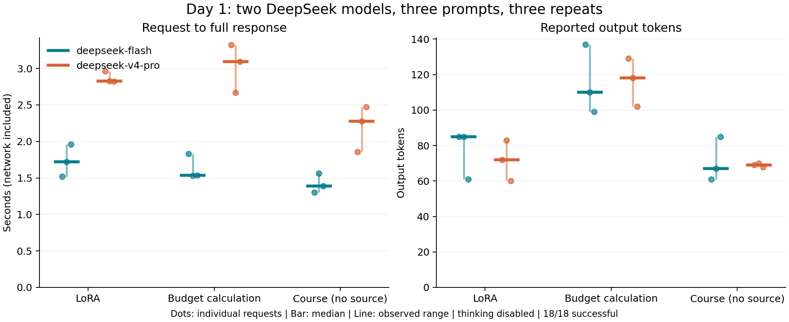

# 第1回 解答：実装・発展

## 取り組んだ範囲

**実装課題の会話履歴機能に加え、発展課題の応答時間・Token数の実測比較を行いました。** DeepSeekの2モデル、3種類の質問、各3回の計18回を実行し、18回すべて正常終了しました。講義の演習説明P.14にある、複数モデル・質問の比較と無料枠のレート制限に関する考察を以下にまとめます。

提出時点との区別：Omnicampusには実装課題として提出済みです。当時の状態はコミット `af01096683aa4993d74b1972e61219c1fe7b358c`、ブランチ `day1-submitted-implementation` に保存しています。以下の発展レポートは、その提出後に追加整理したものです。フォームの変更・再提出は行っていません。実測時刻とレポート公開時刻も区別します。

## 実装課題：会話履歴とToken表示

`app/ask.py` の `--chat` で、過去の質問・回答と現在の質問を順番にAPIへ渡します。非空の回答が成功した後だけ履歴に追加し、エラー・空応答時は元の履歴を保持します。Geminiの `user/model` とDeepSeekの `user/assistant` を変換し、両APIに対応しました。履歴はメモリ内だけに保持します。

入力・出力Token数を表示し、統計の欠測は `N/A`、報告された0は0として区別しました。Python 3.12.14で `uv run pytest -q` を実行し、既存11件＋追加19件の**30件が通過**しました。履歴の順序・成功時の追加・失敗時の保持、role変換、Tokenの欠測処理、計測と保存処理をオフラインで確認しました。

```bash
uv sync --frozen --python 3.12
uv run python -m app.ask --chat --provider deepseek --model deepseek-flash "LoRAとは何ですか？"
# 続けて質問し、/exit、/quit、空入力、EOFで終了
```

`DEEPSEEK_API_KEY` は既存設定からプロセスに渡し、コード・Git・ログには保存していません。会話履歴の構造はテストで確認しましたが、今回の18回は独立した単発質問であり、実モデルの複数ターン対話能力を検証したものではありません。

## 発展課題：実験条件

| 項目 | 実際の設定 |
|---|---|
| 実行時刻 | 2026-10-26 16:58:03〜16:58:46 JST（UTC 07:58台） |
| API・モデル | DeepSeek：`deepseek-flash`、`deepseek-v4-pro` |
| 質問 | LoRAの説明、2期間家計の計算、資料未添付の講座固有情報 |
| 回数・順序 | 2モデル×3質問×3反復＝18回。反復内をseed 20261026でシャッフル |
| 設定 | 両モデルthinking disabled、max_tokens 2048、temperatureはプロバイダ既定値 |
| 間隔・並列数 | 開始間隔2秒以上、同時実行1。長い応答では前回終了後に次を開始 |
| 時間測定 | リクエスト開始から応答全体の受信まで。ネットワークを含む |
| 保存・失敗 | 全回答・usage・時刻を逐次保存。自動リトライなし。APIエラー時は停止 |
| 結果 | 正常18、APIエラー0、429が0、打切り0、空応答0 |

質問と採点用の確認基準は[questions.json](questions.json)にあります。APIには質問本文だけを渡し、正解・確認基準・講義資料は渡していません。実行コードは提出済みコミットと同じものを使用し、指紋と計画を[manifest.json](results/20261026T075803140900Z/manifest.json)に記録しました。モデル名はAPIが返したエイリアスであり、不変のモデル版を固定できたとは主張しません。

## 応答時間とToken数

以下は各条件3回の中央値です。括弧内は最小〜最大。入力・出力・合計はAPIのusageに基づきます。

| 質問 | モデル | 応答秒：中央値（範囲） | 入力Token | 出力Token中央値 | 合計Token中央値 |
|---|---|---:|---:|---:|---:|
| LoRA | Flash | 1.722（1.518〜1.958） | 28 | 85 | 113 |
| LoRA | Pro | 2.824（2.820〜2.964） | 28 | 72 | 100 |
| 計算 | Flash | 1.533（1.528〜1.831） | 95 | 110 | 205 |
| 計算 | Pro | 3.093（2.666〜3.322） | 95 | 118 | 213 |
| 講座情報 | Flash | 1.389（1.304〜1.564） | 88 | 67 | 155 |
| 講座情報 | Pro | 2.274（1.857〜2.470） | 88 | 69 | 157 |



この実験では3質問ともFlashの応答時間中央値が短く、Proは約1.64〜2.02倍でした。一方、LoRAではProの出力Token中央値が小さくても応答は遅かったため、回答の長さだけでは時間差を説明できません。ネットワーク・待ち行列・バックエンド等を分離していないので、モデル構造による原因は断定しません。

入力Tokenは同じ質問で両モデルとも一致しました。出力は同じ質問でも反復間で変動しました。キャッシュ入力は全18回で報告値0、思考Tokenの独立した統計は全18回で欠測でした。thinking disabledという設定と、思考Tokenが0と観測されたことは別なので、欠測を0で補いません。

## 回答原文の比較と正確性

全18回答を[results.md](results/20261026T075803140900Z/results.md)に保存しました。以下はCodexによる原文の手動確認であり、独立した人間の採点結果ではありません。

| 質問 | 確認基準 | 観察結果 |
|---|---|---|
| LoRA | 元の重みを固定し低ランクの差分を学習する仕組み、資源節約 | 6/6が説明。Flashの第2回は行列A・Bに言及し、Proの第3回は短く要点を提示。全回答150字以内 |
| 計算 | 現在価値100＋121÷1.1＝210、第2期消費121−10×1.1＝110 | 6/6で数値と式が正しい。Pro第1回は残りの現在価値100を1.1倍し、他の回答は借入10・返済11から説明 |
| 講座情報 | 資料がない状況で未確認情報を捏造せず不確実性を示す | 6/6が確認不能と回答し、具体的なレベル・提出内容を推測しなかった。正解を答えたとは数えない |

計算は正しくても、**Pro第1回216字、Flash第1回209字で200字の指定を超えました**。ここでの文字数は改行・空白・Markdownを含むPython `len(answer)` のUnicodeコードポイント数です。授業の厳密な字数採点と同一とは仮定しませんが、同じ測定規則では6回中4回が上限内でした。正確性と指示遵守を別に評価する必要があります。

講座情報の質問は「確認できない情報を推測しない」と明示しているため、今回の6例だけで一般的にハルシネーションを防げるとは言えません。LoRAと計算では両者とも基準を満たし、この小標本ではProの品質優位は確認できませんでした。[review.json](results/20261026T075803140900Z/review.json)に各回答の判定と文字数を記録しました。

## 無料枠・レート制限との関係

今回は既存契約のDeepSeek APIを使ったため、Gemini無料枠そのものの実測ではありません。Gemini公式資料では、RPM・入力TPM・RPDが別々に評価され、どれかを超えると制限エラーになります。実際の上限はモデル・プロジェクト・利用階層に依存するため、AI Studioで確認が必要です。[Google公式](https://ai.google.dev/gemini-api/docs/rate-limits)

18回を1分以内に実行した今回の条件では、仮に全体のRPM上限が18未満なら間隔の延長が必要です。ただし今回の各モデルは9回なので、モデル別の枠であれば各9回として判断します。一定のRPM上限Rに対して開始間隔を少なくとも60/R秒程度にすることは目安ですが、他の同時利用・窓の境界・TPM・RPDも確認する必要があります。入力1266 Tokenという総量が小さくてもRPMに抵触する可能性は残ります。会話履歴を伸ばせば毎回再送する入力が増えるため、対話機能ではTPMと費用も増えます。

DeepSeek公式ではアカウント単位の同時接続制限が示され、確認時点でFlash 2500、Pro 500でした。今回の同時実行は1です。18回で429がなかったのはこの条件での観察であり、制限がない証拠でも無料枠の保証でもありません。課題のために意図的な枠の使い切りは行いませんでした。[DeepSeek公式](https://api-docs.deepseek.com/quick_start/rate_limit/)

## 費用と再現性

事前上限はUSD 0.25。API報告値は、Flashが入力633・出力790、Proが入力633・出力771 Token、キャッシュ入力は0です。実行時間帯に対応する公式ピーク料金（100万Token当たり、Flash入力0.30／出力1.20、Pro入力1.32／出力3.96 USD）で計算すると、**合計約USD 0.00503**です。これはusageと料金表による推計であり、請求書・残高差分で実請求を確認した値ではありません。[料金表](https://api-docs.deepseek.com/quick_start/pricing/)／[計算記録](results/20261026T075803140900Z/cost_estimate.json)

測定値は[JSONL](results/20261026T075803140900Z/attempts.jsonl)、[CSV](results/20261026T075803140900Z/results.csv)、[集計JSON](results/20261026T075803140900Z/summary.json)に保存しています。[EXPERIMENT.md](EXPERIMENT.md)に再実行コマンド、[plot_day1.py](../../scripts/plot_day1.py)に図の再生成方法があります。図の再生成はAPIを呼びません。API再実行は新たな費用が発生し、モデルの変更や確率的な出力のため同一結果を保証しません。

## 工夫・難しかった点・AI利用

計測コードを単発の表示で終わらせず、順序、設定、失敗、欠測、原文を残して追跡可能にしました。異なるAPIのrole・usage形式を揃えながら、未取得値を0と混同しない点に注意しました。各条件3回の短時間測定なので、統計的な優越性や一般的な速度順位は主張しません。

設計、コード作成、テスト実行、API実験、原文確認、報告整理にはCodexを利用しました。本人の理解・人手での再確認・最終フォーム提出と、AIが実行した検証は区別しています。検証記録は[VERIFICATION.json](VERIFICATION.json)にあります。
